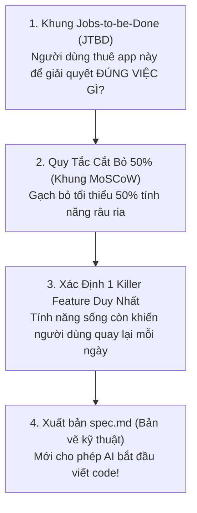

# 📘 Playbook 08: Phân Tích Nghiệp Vụ & Chống Bệnh "Nhồi Nhét Tính Năng" (MVP Scoping & Business Analysis)

> *"Một ứng dụng giải quyết xuất sắc ĐÚNG MỘT vấn đề cốt lõi luôn đánh bại một ứng dụng có mười tính năng nửa vời được chắp vá bằng AI."*

---

## 1. Nỗi Đau Lớn Nhất Của Người Vibecode: Bệnh "Feature Bloat"

Khi có trong tay các mô hình AI mạnh mẽ, lập trình viên thường mắc một sai lầm chết người: **Nghĩ ra cái gì là bảo AI code cái đó ngay lập tức**.
- Thấy người ta có đăng nhập Google $\to$ Đòi AI tích hợp Auth.
- Thấy người ta có Dark mode $\to$ Bảo AI làm nút chuyển màu.
- Thấy người ta có thông báo đẩy, chia sẻ mạng xã hội, bảng thống kê đa chiều $\to$ Nhét tất cả vào prompt.

### Hậu quả khoa học:
1. **Ngộ độc cửa sổ nhớ (Context Bloat & Degradation)**: Khi một dự án chưa xong tính năng cốt lõi mà đã có hàng chục file phụ trợ, Context Window của AI bị quá tải. Mô hình bắt đầu lú lẫn, quên các biến toàn cục và sinh mã trùng lặp.
2. **Ảo giác tiến độ**: Bạn thấy giao diện có nhiều nút bấm, nhưng thực chất không có tính năng nào chạy trơn tru đến nơi đến chốn. Dự án nhanh chóng bị "brick" (tê liệt hoàn toàn).

---

## 2. Khung Phân Tích Nghiệp Vụ Trước Khi Gõ Code

Tuyệt đối **KHÔNG BAO GIỜ** mở AI lên gõ lệnh tạo mã khi chưa trả lời xong 3 câu hỏi sau trên giấy:



### 2.1. Khung Jobs-to-be-Done (JTBD)
Khách hàng không mua "cái máy khoan", họ mua "cái lỗ 10mm trên tường". Đừng bao giờ hỏi *"App của tôi có những tính năng gì?"*, hãy hỏi:
> *"Người dùng đang gặp nỗi đau cụ thể nào, và hành động trong app giúp họ giải quyết nỗi đau đó nhanh nhất trong bao nhiêu giây?"*

### 2.2. Khung Phân Loại MoSCoW & Quy Tắc Cắt Bỏ 50%
Liệt kê tất cả ý tưởng vào 4 nhóm:
* **MUST HAVE (Bắt buộc phải có - MVP Lõi)**: Tối đa **2 đến 3 chức năng**. Nếu thiếu chúng, app hoàn toàn vô nghĩa (ví dụ: App ghi chú thì *phải gõ được chữ và lưu lại được*).
* **SHOULD HAVE (Nên có)**: Tốt cho trải nghiệm nhưng thiếu vẫn sống được (ví dụ: Tìm kiếm theo từ khóa). $\implies$ **Để dành cho v2.0**.
* **COULD HAVE (Có thể có)**: Làm đẹp, hiệu ứng, tiện ích nhỏ. $\implies$ **Gạch bỏ ngay**.
* **WON'T HAVE (Tuyệt đối không làm ở v1.0)**: Đăng nhập đa nền tảng, Thanh toán tự động, Phân quyền đa cấp, Chatbot phụ trợ... $\implies$ **CẤM AI đụng vào**.

---

## 3. Mẫu Prompt Định Hình Nghiệp Vụ Chuẩn (Socratic Product Framing)

Trước khi viết code, hãy dán prompt này vào AI để nó đóng vai Giám đốc sản phẩm (PM) phản biện:

```markdown
Tôi muốn làm một ứng dụng có tên tạm thời là: [TÊN APP].
Ý tưởng sơ bộ của tôi là: [MÔ TẢ Ý TƯỞNG TRONG 3 CÂU].

BẠN LÀ MỘT GIÁM ĐỐC SẢN PHẨM (HEAD OF PRODUCT) KHẮT KHE:
1. Hãy phản biện ý tưởng này: Đâu là 3 ngộ nhận sai lầm mà tôi đang ảo tưởng về nhu cầu người dùng?
2. Hãy áp dụng quy tắc "Cắt bỏ 50% tính năng": Chỉ giữ lại DUY NHẤT 1 tính năng cốt lõi (Killer Feature) cho bản MVP đầu tiên.
3. Liệt kê 5 tính năng mà tôi TUYỆT ĐỐI KHÔNG ĐƯỢC PHÉP LÀM trong tuần đầu tiên để tránh bị vỡ trận.
4. Thiết kế cho tôi luồng đi của người dùng (User Journey) từ lúc mở app đến khi hoàn thành mục tiêu trong đúng 3 bước ngắn gọn nhất.
```

---

## 4. Bản Kiểm Tra Trước Khi Phê Duyệt Triển Khai (Go/No-Go Checklist)

- [ ] Ứng dụng chỉ phục vụ **ĐÚNG 1 ĐỐI TƯỢNG CỤ THỂ** (không nói chung chung là "tất cả mọi người").
- [ ] Tính năng cốt lõi (Killer Feature) có thể chạy thử nghiệm được trong vòng **dưới 15 phút** mà không cần tài khoản đăng nhập.
- [ ] Toàn bộ các tính năng "làm màu" (Dark mode, mạng xã hội, chia sẻ, animation phức tạp) đã được chuyển sang nhóm **Won't Have**.
- [ ] Luồng người dùng chỉ có tối đa **3 thao tác chạm/click** để nhận được giá trị đầu tiên.
