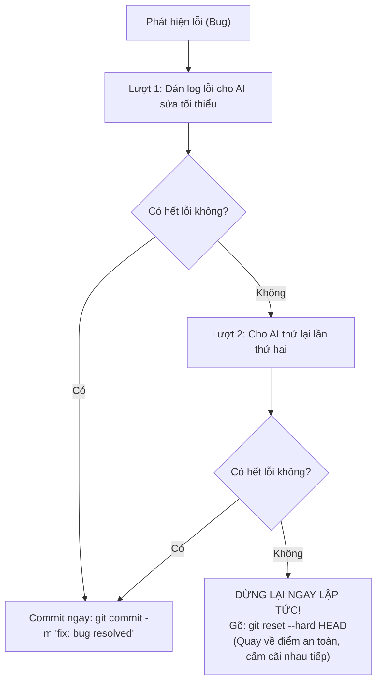

# 📘 Playbook 09: Mindful Vibecoding & Làm Chủ Kiến Trúc Công Nghệ (Tech Stack Mastery & Anti-Cognitive Debt)

> *"Lập trình viên đỉnh cao không đo lường bằng việc gõ được bao nhiêu dòng mã, mà bằng sự thấu hiểu tường minh về luồng dữ liệu và lý do tại sao hệ thống vận hành như vậy."*

---

## 1. Nỗi Đau: Mất Quyền Làm Chủ & "Mù Công Nghệ" Khi Vibecode

Nhiều lập trình viên khi sử dụng AI gặp phải cảm giác hoang mang tột độ:
- *"App của tôi chạy được, nhưng tôi hoàn toàn không biết nó đang dùng những thư viện gì bên dưới."*
- *"Cứ thấy lỗi là copy nguyên log dán vào cho AI sửa, sửa chỗ này thì nát chỗ khác."*
- *"Tôi làm xong 5 cái app nhưng cảm giác đầu óc vẫn rỗng tuếch, không hề tiến bộ về tư duy kỹ thuật hay sản phẩm."*

Khoa học nhận thức (*arXiv:2609.09022 & arXiv:2609.23859*) định danh đây là **"Món nợ nhận thức" (Cognitive Debt)** và **"Bẫy viết lại toàn bộ mã" (The Reimplementation Trap)**: Người dùng trở thành nô lệ thử nghiệm thụ động cho AI, mất hoàn toàn khả năng giám sát kiến trúc.

---

## 2. Giao Thức Tệp `TECH_STACK.md` Bắt Buộc

Trước khi viết bất kỳ file mã nguồn nào, hãy bắt buộc AI phải xuất bản tệp `TECH_STACK.md` ngay tại thư mục gốc của dự án:

```markdown
# HỒ SƠ CÔNG NGHỆ & LUỒNG KIẾN TRÚC (TECH_STACK.MD)

## 1. DANH SÁCH CÔNG NGHỆ & VAI TRÒ
- **Next.js 15 (App Router)**: Khung xương full-stack, xử lý routing trang và Server Actions.
- **TypeScript (Strict Mode)**: Vòng kim cô khóa chặt kiểu dữ liệu, bắt lỗi ảo giác ngay lúc gõ phím.
- **Tailwind CSS + shadcn/ui**: Hệ thống giao diện nguyên tử, triệt tiêu xung đột CSS.
- **Supabase (PostgreSQL)**: Cơ sở dữ liệu quan hệ và cơ chế xác thực phiên người dùng.
- **Zod**: Cửa khẩu an ninh kiểm tra dữ liệu đầu vào (Schema Validation).

## 2. LÝ DO CHỌN BỘ NÀY (ARCHITECTURAL TRADE-OFFS)
- Tại sao dùng Supabase thay vì MongoDB? Vì dữ liệu User và Orders có tính ràng buộc toàn vẹn cao, tránh bị lỗi mất liên kết.
- Tại sao dùng Zod? Vì nó tự động suy luận TypeScript types, giúp không phải viết lặp lại kiểu dữ liệu 2 lần.

## 3. BẢN ĐỒ LUỒNG DỮ LIỆU (DATA FLOW DIAGRAM)
User bấm nút "Lưu" -> Form gửi qua Server Action (app/actions.ts)
  -> Zod kiểm tra dữ liệu:
     ❌ Sai kiểu: Báo lỗi đỏ về form (không gọi Database).
     ✅ Hợp lệ: Gọi Supabase Client ghi vào bảng `profiles` -> Trả về kết quả thành công.
```

👉 **Giá trị nhận được**: Đọc file này trong 2 phút giúp bạn nắm chắc 100% linh hồn của dự án. Không bao giờ còn cảm giác "mù mờ về công nghệ".

---

## 3. Quy Tắc 2 Lần Thử (The 2-Strike Git Reset Rule)

Khi ứng dụng gặp lỗi runtime hoặc kiểm thử thất bại, hãy tuân thủ quy trình sau:



### Tại sao tuyệt đối KHÔNG cãi nhau với AI từ lượt thứ 3?
* Nghiên cứu *arXiv:2609.29410 (2026)* chứng minh: Khi tranh cãi quá 2 lượt trong cùng một cửa sổ chat, AI bị **ngộ độc ngữ cảnh (Context Poisoning)**. Trong hơn 70% trường hợp, nó sẽ xóa cả file để viết lại từ đầu, làm hỏng các tính năng cũ đã chạy ngon lành từ trước.
* Lệnh `git reset --hard HEAD` đưa bạn về trạng thái an toàn chỉ trong **1 giây**.

---

## 4. Kỹ Thuật "Học Từ Lỗi" (Root-Cause Post-Mortem)

Để thực sự tiến bộ về tư duy sản phẩm sau mỗi dự án, mỗi khi gặp một con bug hóc búa, hãy dừng AI lại bằng câu hỏi này:

```markdown
Dừng viết mã lại. Tuyệt đối không đưa code sửa vội. Hãy phân tích cho tôi:
1. Nguyên nhân gốc rễ (Root Cause) sâu xa vì sao lỗi này lại xảy ra?
2. Có phải do kiến trúc dữ liệu của chúng ta thiết kế thiếu trường hợp biên (Edge Case) không?
3. Nếu sửa đúng cách thì cần sửa tối thiểu ở những dòng nào thay vì viết lại cả file?
```

👉 **Kết quả**: Mỗi con bug trở thành một bài giảng kiến trúc vô giá. Bạn không còn là thợ sửa lỗi mù quáng mà trở thành người nắm vững nguyên lý hoạt động của hệ thống.

---

## 5. Bảng Nhận Diện: Tech Stack "Thân Thiện" vs "Thù Địch" Với Vibecoding

| Tiêu chí | Hệ sinh thái Thân Thiện (Vibe-Friendly) | Hệ sinh thái Thù Địch (Vibe-Hostile - Cần Tránh) |
| :--- | :--- | :--- |
| **Giao diện (Frontend)** | TypeScript + React + Tailwind + shadcn/ui. Bắt lỗi compiler lập tức khi AI bịa biến. | Vanilla JavaScript không types, PHP cũ, CSS thuần. AI bịa biến không ai cản. |
| **Xử lý nền (Backend)** | Python (FastAPI + Pydantic) hoặc Next.js + Zod. Kiểm tra kiểu tự động tại cổng vào. | Ngôn ngữ không có schema validation. Dữ liệu rác lọt sâu vào database gây nát hệ thống. |
| **Cơ sở dữ liệu** | PostgreSQL (Supabase / Drizzle ORM). Ràng buộc chặt chẽ, SDK chuẩn AI thuộc làu. | NoSQL phi cấu trúc lỏng lẻo. AI thay đổi cấu trúc bảng tùy tiện làm mất dữ liệu. |
| **Kiểm thử** | Playwright (Headless Browser) tự động click chuột và chụp ảnh màn hình kiểm tra. | Bấm tay thủ công, không có kiểm thử tự động, bug ngầm tích tụ âm thầm. |
