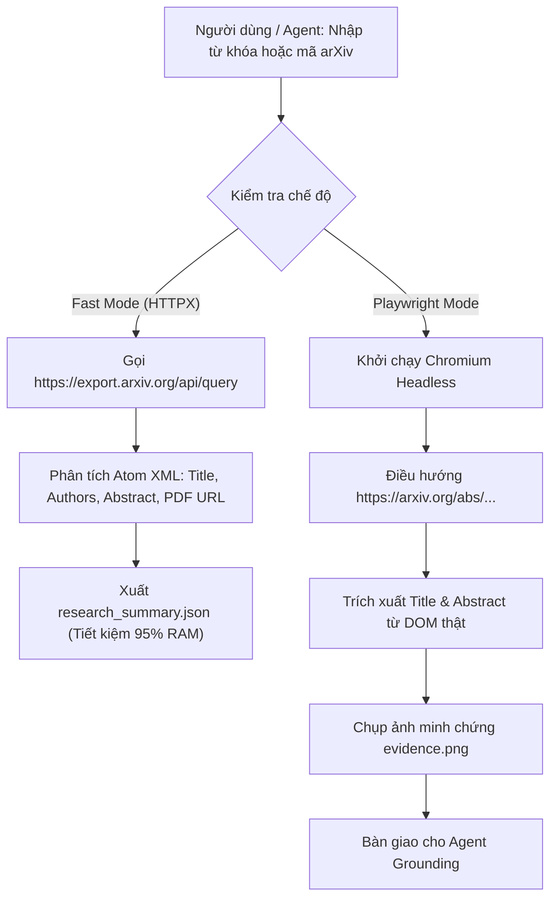
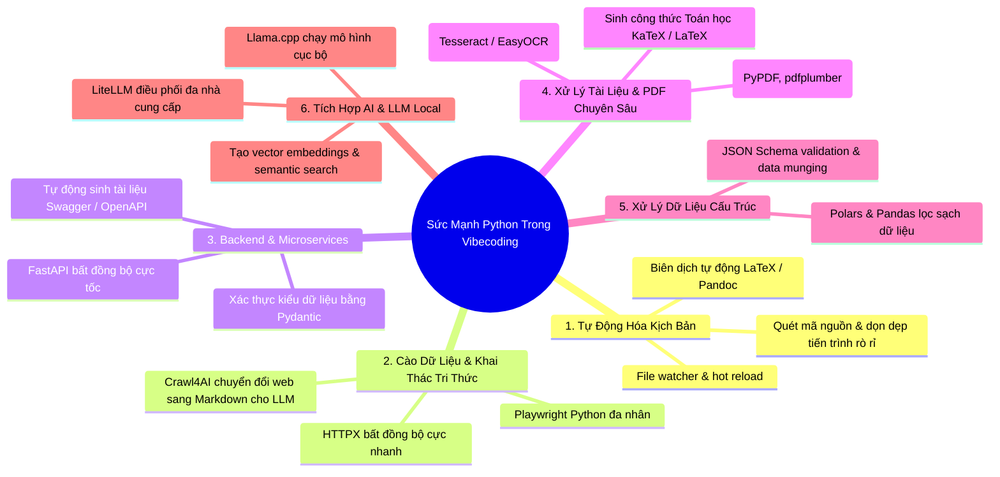

# Hướng Dẫn Thực Chiến Vibecoding: Playwright, Python & Vòng Lặp Tự Sửa Lỗi (Self-Healing Loop)

> **Mục tiêu tài liệu**: Tài liệu này không dừng lại ở lý thuyết suông. Đây là **bản thiết kế thực hành từng bước (Actionable Blueprint)** giải thích cặn kẽ:
> 1. Playwright có thể làm được những gì trong thực tế và các công cụ nào thay thế hay hơn, dễ dùng hơn (Crawl4AI, Browser-use, HTTPX).
> 2. Kịch bản thực chiến 1: Tự động hóa tìm kiếm, thẩm định và bóc tách bài báo khoa học (arXiv Research Pipeline).
> 3. Kịch bản thực chiến 2: Tự động kiểm thử WebApp cục bộ, bắt lỗi và xuất file báo cáo để AI Agent tự sửa mã nguồn (*Self-Healing Loop-until-green*).
> 4. Python có thể làm được những gì trong Vibecoding: 6 trụ cột sức mạnh & So sánh chiến lược Python vs TypeScript.

---

## PHẦN 1: GIẢI PHẪU PLAYWRIGHT THỰC CHIẾN & CÁC CÔNG CỤ THAY THẾ TỐI ƯU

### 1.1 Bảy siêu năng lực thực chiến của Playwright trong Vibecoding
Khi lập trình cùng các tác tử AI (như Antigravity, Claude Code, Cursor), Playwright đóng vai trò là "đôi mắt và bàn tay" của tác tử. Dưới đây là 7 khả năng thực tế:

1. **Headless Browser Automation**: Khởi chạy Chromium, Firefox, WebKit hoàn toàn ngầm không giao diện, tương thích 100% môi trường Linux/CI.
2. **Lắng nghe & Bắt chặn gói tin (Network Interception & Mocking)**:
   - Nghe trộm dữ liệu API máy khách gửi lên (`page.on('request')`).
   - Sửa đổi hoặc giả lập dữ liệu trả về từ máy chủ (`page.route('**/api/users', route => route.fulfill({...}))`) để test lỗi 500, lỗi mạng chậm mà không cần sửa backend.
3. **Cơ chế Tự động chờ phần tử (Auto-Waiting)**:
   - Tự động chờ phần tử hiển thị (Visible), không bị che khuất và sẵn sàng nhận click.
   - Loại bỏ hoàn toàn các lệnh `time.sleep(3)` thô sơ gây chậm kịch bản.
4. **Bắt trọn lỗi Console & Uncaught Exceptions**:
   - `page.on('console', msg => ...)` bắt toàn bộ `console.error` của React/Vue.
   - `page.on('pageerror', err => ...)` bắt các lỗi Hydration Mismatch, Crash do null pointer.
5. **Chụp ảnh màn hình & So sánh thị giác (Visual Regression)**:
   - Chụp full-page screenshot làm bằng chứng cho AI Agent "nhìn" thấy giao diện thật.
6. **Lưu trữ phiên đăng nhập (Storage State / Cookies)**:
   - Lưu trạng thái đăng nhập vào tệp `auth.json` sau lần đăng nhập đầu tiên, các lần chạy sau chỉ việc nạp lại mà không phải gõ mật khẩu hay giải OTP.
7. **Trích xuất dữ liệu DOM động từ Single Page Applications (SPA)**:
   - Chờ React/Next.js tải xong dữ liệu qua client-side fetching rồi mới bóc tách nội dung HTML.

---

### 1.2 Khi nào Playwright quá nặng? Các công cụ thay thế hay hơn & dễ hơn

Mặc dù Playwright rất mạnh, **việc lạm dụng Playwright cho mọi tác vụ là một sai lầm nghiêm trọng**. Mỗi phiên Chromium ngốn từ **250MB đến 600MB RAM** và mất 2-4 giây khởi động.

Dưới đây là bảng so sánh các công cụ thay thế để bạn lựa chọn đúng vũ khí:

| Công cụ | Bản chất kỹ thuật | Tiêu thụ RAM | Tốc độ | Khả năng vượt JS động | Độ dễ tích hợp với AI Agent | Khi nào nên sử dụng? |
| :--- | :--- | :--- | :--- | :--- | :--- | :--- |
| **Playwright** | Full Browser Automation (Chromium) | 300 - 600 MB | Trung bình (2-5s) | Cực mạnh ($100\%$) | Trung bình (Cần viết selector CSS/XPath) | **Bắt buộc khi test WebApp tương tác, bắt lỗi Console/Hydration, chụp screenshot giao diện.** |
| **Crawl4AI** | Async Crawler chuyên dụng cho LLM | 80 - 150 MB | Rất nhanh (0.5-1.5s) | Rất mạnh (Dùng Playwright ngầm tối ưu) | **Cực dễ** (Tự chuyển web thành Markdown sạch, trích xuất JSON theo Schema) | **Cực hay khi cần cào bài viết, tài liệu, blog đưa thẳng vào context của LLM.** |
| **Browser-Use / Stagehand** | AI-Agent Browser Automation | 400 - 700 MB | Chậm (do gọi LLM suy luận) | Cực mạnh | **Dễ nhất** (Chỉ cần ra lệnh bằng tiếng Anh/Việt, không cần viết CSS selector) | Khi trang web có cấu trúc quá phức tạp, selector thay đổi liên tục, cần AI tự tìm nút bấm. |
| **HTTPX + BeautifulSoup** | HTTP Client thuần túy + HTML Parser | **10 - 20 MB** | **Siêu tốc (< 0.2s)** | Không chạy được JavaScript | Rất dễ | **Cực hay cho API, cào arXiv, Wikipedia, các trang HTML tĩnh. Tiết kiệm 95% RAM!** |

> 💡 **Quy tắc vàng của Vibecoder**: Nếu trang web có API REST/RSS công khai (như arXiv, GitHub, HackerNews), **luôn ưu tiên dùng HTTPX API**. Chỉ khởi động Playwright khi trang web bắt buộc phải render JavaScript hoặc cần test tương tác click/giao diện!

---

## PHẦN 2: THỰC CHIẾN 1 - TỰ ĐỘNG HÓA TÌM KIẾM & BÓC TÁCH BÀI BÁO KHOA HỌC

### Luồng xử lý kép: Fast HTTPX API + Playwright Fallback

Trong dự án, chúng ta đã xây dựng công cụ [`scripts/paper_harvester.py`](file:///home/tontonyuta/Documents/Vibecoding/scripts/paper_harvester.py) hoạt động theo mô hình 2 chế độ:



### Cách sử dụng dòng lệnh trong thực tế:

```bash
# 1. Tra cứu siêu tốc bằng API thuần (Mất 0.8s, tiêu thụ 15MB RAM):
/home/tontonyuta/.venv/bin/python scripts/paper_harvester.py "2610.14766" --mode fast

# 2. Tìm kiếm nhiều bài báo theo từ khóa và tự động tải PDF:
/home/tontonyuta/.venv/bin/python scripts/paper_harvester.py "agentic software engineering" --mode fast --limit 5 --download-pdf

# 3. Thẩm định trang web và chụp ảnh minh chứng bằng Playwright:
/home/tontonyuta/.venv/bin/python scripts/paper_harvester.py "2610.14766" --mode playwright
```

---

## PHẦN 3: THỰC CHIẾN 2 - KIỂM THỬ WEBAPP & VÒNG LẶP TỰ SỬA LỖI (SELF-HEALING LOOP)

### Cơ chế hoạt động của Self-Healing Loop-until-green

Khi bạn vibecode một ứng dụng web (Next.js, Vite, React) trên `http://localhost:3000`:
1. Thay vì bạn phải tự mở Chrome, bấm F12, đọc lỗi rồi copy vào chat, **AI Agent sẽ kích hoạt [`scripts/self_healing_test_runner.py`](file:///home/tontonyuta/Documents/Vibecoding/scripts/self_healing_test_runner.py)**.
2. Công cụ này quét sạch 4 tầng:
   - `console.error` (Lỗi logic React, cảnh báo khóa, deprecation).
   - `pageerror` (Lỗi cú pháp, TypeError `cannot read property of undefined`).
   - `response.status >= 400` (Lỗi API 404, 500, 502).
   - `requestfailed` (Lỗi CORS hoặc server backend chưa bật).
3. Nếu phát hiện lỗi:
   - Chụp ngay ảnh màn hình `failure_screenshot.png`.
   - Ghi báo cáo máy đọc được vào `agent_feedback.json` kèm chính xác dòng code gây lỗi.
   - Trả về **Exit Code 1**.
4. AI Agent đọc `agent_feedback.json`, định vị đúng tệp mã nguồn và sửa lỗi.
5. AI Agent tự chạy lại `self_healing_test_runner.py`. Khi hết sạch lỗi, công cụ trả về **Exit Code 0** $\to$ Nhiệm vụ hoàn thành!

### Cấu trúc tệp dữ liệu máy đọc `agent_feedback.json`

```json
{
  "timestamp": "2026-10-23T02:51:27",
  "target_url": "http://localhost:3000",
  "status": "FAILED",
  "summary": {
    "total_errors": 2,
    "console_errors_count": 1,
    "network_failures_count": 1
  },
  "details": {
    "console_errors": [
      {
        "text": "TypeError: Cannot read properties of undefined (reading 'map')",
        "location": { "url": "http://localhost:3000/src/QuestionList.tsx", "lineNumber": 42 }
      }
    ],
    "network_failures": [
      { "url": "http://localhost:8000/api/questions", "status": 404 }
    ]
  },
  "recommended_action_for_agent": [
    "Khởi tạo giá trị mặc định mảng rỗng [] cho biến questions trước khi gọi .map()",
    "Sửa endpoint API từ /api/questions thành /api/v1/questions theo đặc tả backend"
  ]
}
```

---

## PHẦN 4: PYTHON CÓ THỂ LÀM ĐƯỢC NHỮNG GÌ TRONG KỶ NGUYÊN VIBECODING?

Rất nhiều người lầm tưởng Python chỉ dùng cho khoa học dữ liệu. Trong quy trình Vibecoding hiện đại, **Python là chất keo kết dính (The Ultimate Automation Glue)** với 6 trụ cột sức mạnh:



### Bảng so sánh chiến lược: Khi nào dùng Python vs Khi nào dùng TypeScript khi Vibecode?

| Nhiệm vụ / Bối cảnh | Ngôn ngữ tối ưu | Lý do lựa chọn |
| :--- | :--- | :--- |
| **Xây dựng Giao diện (Frontend Web/Mobile)** | **TypeScript** (Next.js, Vite, React) | TypeScript có hệ sinh thái component (Tailwind, shadcn/ui) và JSX/TSX trực quan nhất. |
| **Kịch bản tự động hóa, kiểm thử, Agent Tooling** | **Python** | Cú pháp ngắn gọn, thư viện phong phú (`playwright`, `httpx`, `os`, `shutil`), viết kịch bản 30 dòng chạy ngay không cần cấu hình tsconfig hay build step. |
| **Dịch vụ AI Backend, xử lý Toán/PDF/OCR** | **Python** (FastAPI) | Toàn bộ hệ sinh thái AI/ML và thư viện xử lý PDF mạnh nhất đều nằm ở Python. |
| **Ứng dụng Full-Stack Monorepo thương mại** | **TypeScript** (tRPC, Next.js) | Đem lại End-to-End Type Safety xuyên suốt từ cơ sở dữ liệu đến giao diện. |
| **Cào dữ liệu & Nghiên cứu học thuật tự động** | **Python** | Khả năng kết hợp giữa HTTPX, BeautifulSoup, Playwright và Pydantic giúp parse dữ liệu chỉ trong vài dòng code. |

---

## TỔNG KẾT BỘ CÔNG CỤ THỰC HÀNH CÓ SẴN TRONG DỰ ÁN

Tất cả các công cụ trên đã được cài đặt và kiểm thử hoàn chỉnh tại:
- Công cụ nghiên cứu bài báo: [`scripts/paper_harvester.py`](file:///home/tontonyuta/Documents/Vibecoding/scripts/paper_harvester.py)
- Công cụ tự test webapp và xuất báo cáo tự sửa: [`scripts/self_healing_test_runner.py`](file:///home/tontonyuta/Documents/Vibecoding/scripts/self_healing_test_runner.py)
- Kịch bản biên dịch tài liệu LaTeX chuẩn in ấn: [`scripts/compile_latex.sh`](file:///home/tontonyuta/Documents/Vibecoding/scripts/compile_latex.sh)
- Thư viện tài liệu học thuật PDF chất lượng cao: [`tailieu_latex/`](file:///home/tontonyuta/Documents/Vibecoding/tailieu_latex/)
