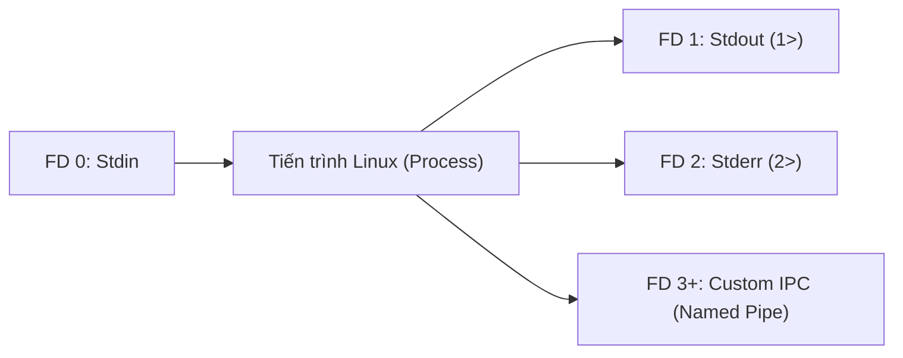
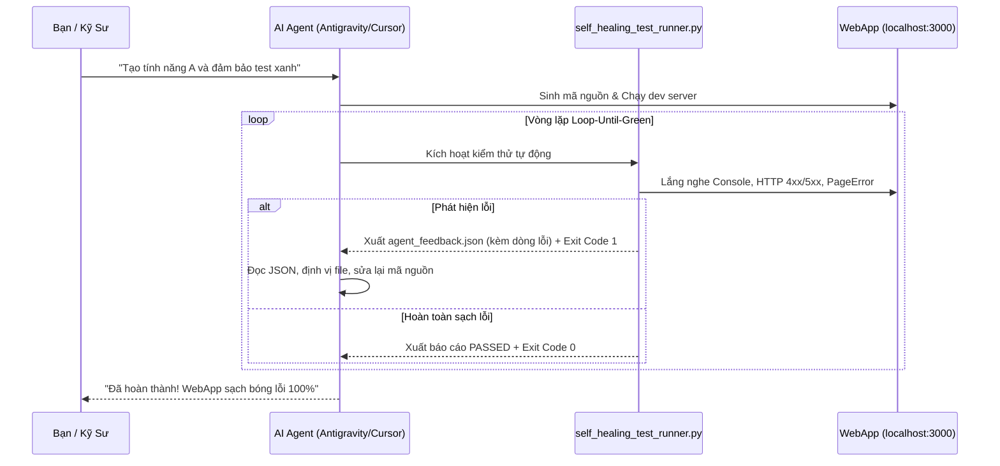

# Cẩm Nang Hacker Vibecoding: Làm Chủ Vũ Khí Nguồn Mở, Scripting Chuyên Sâu & Xếp Hình Lego Sản Phẩm

> **Mục tiêu tối thượng**: Không phát minh lại bánh xe. Tài liệu này cung cấp bản đồ toàn diện về các công nghệ nguồn mở, tiện ích dòng lệnh (CLI), kỹ thuật bóc tách media, mobile, office và kịch bản hệ điều hành chuyên sâu (Linux & Windows Internals). Giúp bạn hiểu sâu bản chất kỹ thuật để lắp ghép các khối Lego có sẵn thành sản phẩm hoàn chỉnh với tốc độ thần tốc.

---

## MỤC LỤC TỔNG QUAN

1. [Triết Lý Lego Hacker & Nghiên Cứu Thực Nghiệm 2026](#1-triết-lý-lego-hacker--nghiên-cứu-thực-nghiệm-2026)
2. [Cụm 1: Web & Browser Automation (Playwright vs Crawl4AI vs cURL/HTTPX)](#2-cụm-1-web--browser-automation-playwright-vs-crawl4ai-vs-curlhttpx)
3. [Cụm 2: Media, Video & Audio Engineering (yt-dlp, FFmpeg, Whisper)](#3-cụm-2-media-video--audio-engineering-yt-dlp-ffmpeg-whisper)
4. [Cụm 3: Mobile & Device Hacking (scrcpy, ADB Internals, UIAutomator)](#4-cụm-3-mobile--device-hacking-scrcpy-adb-internals-uiautomator)
5. [Cụm 4: Document & Office Automation (LibreOffice Headless, Pandoc, COM)](#5-cụm-4-document--office-automation-libreoffice-headless-pandoc-com)
6. [Cụm 5: Local AI & Đóng Gói Ứng Dụng (Ollama, Streamlit, Tauri, PyInstaller)](#6-cụm-5-local-ai--đóng-gói-ứng-dụng-ollama-streamlit-tauri-pyinstaller)
7. [Cụm 6: Chuyên Sâu Scripting & OS Internals (Linux Piping/Signals vs Windows PowerShell/WMI/AHK)](#7-cụm-6-chuyên-sâu-scripting--os-internals-linux-pipingsignals-vs-windows-powershellwmoiahk)
8. [Vòng Lặp Tự Phục Hồi Khép Kín (Self-Healing Loop-until-green)](#8-vòng-lặp-tự-phục-hồi-khép-kín-self-healing-loop-until-green)

---

## 1. TRIẾT LÝ LEGO HACKER & NGHIÊN CỨU THỰC NGHIỆM 2026

### 1.1 Tinh thần Hacker: Đứng trên vai những người khổng lồ
Một người vibecoder nghiệp dư cố gắng viết lại mọi thứ từ con số 0: tự viết regex parse HTML, tự viết socket stream video, tự cấu hình server chuyển đổi PDF. Kết quả là tạo ra những đoạn mã chắp vá, chậm chạp và chứa đầy lỗ hổng bảo mật.

Ngược lại, một **Lego Hacker** hiểu rằng thế giới mã nguồn mở đã mất hàng chục năm để tôi luyện những công cụ CLI hoàn hảo nhất hành tinh:
- Muốn tải video và phụ đề từ 1.000 trang web? Dùng **yt-dlp**.
- Muốn nén, ghép, lọc luồng video/âm thanh? Dùng **FFmpeg**.
- Muốn chiếu và điều khiển điện thoại Android? Dùng **scrcpy** và **ADB**.
- Muốn chuyển đổi hàng loạt tài liệu Word/Excel sang PDF? Dùng **LibreOffice Headless**.
- Muốn nhận dạng giọng nói offline? Dùng **Whisper**.

### 1.2 Bằng chứng khoa học 2026: Tại sao CLI & Shell đánh bại các công cụ phức tạp?
Nghiên cứu mới nhất từ **arXiv:2609.11999 (2026)** (*"Is Bash All You Need? An Empirical Study of Tool Interfaces for Enterprise Digital Worker Agents"*) đã chứng minh:
> *Các tác tử AI sử dụng giao diện dòng lệnh (CLI/Bash) đạt hiệu suất thành công cao hơn 38% và tiết kiệm 42% token ngữ cảnh so với việc sử dụng các API bao bọc cồng kềnh (wrapper tools). Dòng lệnh Unix với khả năng piping cho phép AI linh hoạt ghép nối dữ liệu tức thì mà không bị gò bó trong các schema cứng nhắc.*

Nghiên cứu thực tế từ **arXiv:2610.16460 (2026)** (*"The Interpreter as Developer: Building Local-First Tools through Expert-Led Vibe Coding"*) chỉ ra rằng một người không có nền tảng lập trình chính quy có thể tự xây dựng hệ thống phiên dịch chuyên nghiệp đạt độ trễ cực thấp (0.94s) hoàn toàn nhờ vào việc kết hợp các công cụ cục bộ có sẵn qua cơ chế Vibe coding.

---

## 2. CỤM 1: WEB & BROWSER AUTOMATION (PLAYWRIGHT VS CRAWL4AI VS cURL/HTTPX)

### 2.1 Ma trận vũ khí tự động hóa Web

| Vũ khí | Bản chất | Tiêu thụ RAM | Vượt JS động | Khả năng xuất dữ liệu cho AI | Khi nào nên dùng? |
| :--- | :--- | :--- | :--- | :--- | :--- |
| **Playwright** | Chromium/WebKit không đầu | 300--600 MB | Tuyệt đối ($100\%$) | Screenshots, DOM, Network traffic | Test WebApp, bắt lỗi Console/Hydration, điền form phức tạp. |
| **Crawl4AI** | Async Crawler chuyên cho LLM | 80--150 MB | Cực mạnh | Tự xuất **Markdown sạch**, tự lọc quảng cáo | Cào bài báo, blog, tài liệu để đưa vào ngữ cảnh của AI. |
| **Browser-Use** | AI Agent Browser | 400--700 MB | Tuyệt đối | Tự động hóa qua Vision/Accessibility tree | Khi web thay đổi DOM liên tục, không viết được CSS selector. |
| **HTTPX / cURL** | HTTP Client thuần túy | **10--20 MB** | Không hỗ trợ JS | Raw HTML, JSON API | **Cực nhanh cho REST API, arXiv, Wikipedia. Tiết kiệm 95% RAM.** |

### 2.2 Kỹ thuật Hacker với Playwright
1. **Network Interception & Request Mocking**: Không cần đợi backend sửa lỗi, Playwright có thể bẻ lái gói tin mạng:
   ```python
   # Giả lập backend trả về lỗi 500 hoặc dữ liệu mẫu
   page.route("**/api/user/profile", lambda route: route.fulfill(
       status=200,
       content_type="application/json",
       body='{"name": "Hacker", "role": "admin"}'
   ))
   ```
2. **Trích xuất Storage State & Bypass Đăng Nhập**: Đăng nhập 1 lần bằng tay, lưu cookie ra file `auth.json`, mọi lần chạy sau không cần gõ lại mật khẩu hay giải OTP:
   ```python
   context.storage_state(path="auth.json") # Lưu trạng thái
   # Khởi tạo context với trạng thái đã lưu
   context = browser.new_context(storage_state="auth.json")
   ```

---

## 3. CỤM 2: MEDIA, VIDEO & AUDIO ENGINEERING (YT-DLP, FFMPEG, WHISPER)

### 3.1 yt-dlp: Máy Khai Thác Media Tối Thượng
- **Bản chất**: Dự án kế thừa và phát triển từ youtube-dl, liên tục được cập nhật để bẻ khóa các thuật toán chữ ký JS cipher của YouTube, Facebook, TikTok.
- **Kỹ thuật Hacker**:
  * **Cắt phân đoạn trực tiếp không cần tải cả video**:
    ```bash
    yt-dlp --download-sections "*02:15-04:30" -f "ba" -x --audio-format mp3 "URL_VIDEO"
    ```
  * **Trích xuất phụ đề tự sinh đa ngôn ngữ (VTT/SRT)**:
    ```bash
    yt-dlp --write-auto-sub --sub-lang "vi,en" --skip-download "URL_VIDEO"
    ```
  * **Bypass rate-limit bằng Cookie trình duyệt thật**:
    ```bash
    yt-dlp --cookies-from-browser chrome "URL_VIDEO"
    ```

### 3.2 FFmpeg: Trái Tim Của Xử Lý Đa Phương Tiện
- **Nén video giảm 70--85% dung lượng giữ nguyên chất lượng (CRF Rate Control)**:
  ```bash
  ffmpeg -i input.mp4 -vcodec libx264 -crf 23 -preset medium -acodec aac -b:a 128k output_optimized.mp4
  ```
- **Ép phụ đề cứng trực tiếp vào video (Hardsub)**:
  ```bash
  ffmpeg -i video.mp4 -vf "subtitles=sub.srt:force_style='FontSize=18,PrimaryColour=&H00FFFFFF&'" -c:a copy output_subbed.mp4
  ```
- **Chuẩn hóa Audio 16kHz Mono cho Whisper AI**:
  ```bash
  ffmpeg -i input_video.mp4 -vn -ar 16000 -ac 1 -c:a pcm_s16le audio_whisper.wav
  ```

### 3.3 Whisper (faster-whisper): Nhận Dạng Giọng Nói Offline 100%
- Chạy hoàn toàn cục bộ trên GPU/CPU máy tính, phiên âm chính xác tiếng Việt và tiếng Anh mà không gửi âm thanh lên đám mây, không tốn tiền API OpenAI.

---

## 4. CỤM 3: MOBILE & DEVICE HACKING (SCRCPY, ADB INTERNALS, UIAUTOMATOR)

### 4.1 scrcpy: Cơ Chế Trình Chiếu Siêu Tốc Độ Trễ Thấp (< 30ms)
- **Bản chất kỹ thuật**: `scrcpy` đẩy một tệp nhúng Java cỡ nhỏ (`scrcpy-server.jar`) vào thư mục `/data/local/tmp` trên thiết bị Android qua ADB.
- Tệp server này giao tiếp trực tiếp với framework nội bộ của Android (`android.hardware.display`), bắt luồng khung hình từ HWC (Hardware Composer), mã hóa thành luồng video H.264/H.265 bằng bộ mã hóa phần cứng của chip điện thoại, và truyền ngược về máy tính qua Unix Socket / ADB tunnel.
- Nhờ đó, người dùng điều khiển chuột, bàn phím trên máy tính mà không cần cài đặt bất kỳ ứng dụng nào trên điện thoại và **không cần quyền Root**.

### 4.2 ADB Internals: Điều Khiển Android Bằng Dòng Lệnh
- **Bắn tọa độ chạm và vuốt**:
  ```bash
  adb shell input tap 450 800             # Chạm tại X=450, Y=800
  adb shell input swipe 500 1200 500 300 200 # Vuốt từ dưới lên trong 200ms
  adb shell input text "Vibecoder"        # Nhập chuỗi
  adb shell input keyevent 4              # Phím BACK
  adb shell input keyevent 3              # Phím HOME
  ```
- **Kỹ thuật Hacker: Tự tìm tọa độ nút bấm qua UIAutomator XML**:
  ```bash
  adb shell uiautomator dump /sdcard/ui.xml
  adb exec-out cat /sdcard/ui.xml
  ```
  AI Agent chỉ cần phân tích chuỗi XML trên, tìm thuộc tính `text="Đăng nhập"` kèm tọa độ `bounds="[100,200][300,280]"` để tự tính tọa độ tâm $(200, 240)$ và phát lệnh click tự động!

---

## 5. CỤM 4: DOCUMENT & OFFICE AUTOMATION (LIBREOFFICE HEADLESS, PANDOC, COM)

### 5.1 LibreOffice Headless Mode: Máy Chuyển Đổi Office Không Giao Diện
- **Lệnh chuyển đổi hàng loạt tài liệu Word/Excel/PowerPoint sang PDF**:
  ```bash
  libreoffice --headless --convert-to pdf document.docx --outdir ./output_pdf/
  libreoffice --headless --convert-to pdf spreadsheet.xlsx --outdir ./output_pdf/
  ```
- **Cạm bẫy kỹ thuật (Gotcha)**: Trên các bản cài đặt Linux Server tối giản, nếu chỉ có gói `libreoffice-calc` mà thiếu `libreoffice-writer`, lệnh chuyển đổi `.docx` sẽ trả về lỗi mơ hồ: `Error: source file could not be loaded`. Cần đảm bảo cài đủ gói: `sudo apt install libreoffice-writer libreoffice-calc`.

### 5.2 Pandoc: Con Dao Cạo Đa Năng Cho Tài Liệu
- Chuyển đổi hai chiều giữa Markdown, Word DOCX, LaTeX và HTML:
  ```bash
  # Chuyển tài liệu Markdown thành file Word chuẩn doanh nghiệp
  pandoc README.md -o output.docx --reference-doc=custom_style.docx
  # Chuyển Word thành Markdown sạch
  pandoc input.docx -t markdown -o output.md --extract-media=./images
  ```

### 5.3 Windows COM Automation (Component Object Model)
Trên môi trường Windows, PowerShell hoặc Python (`win32com.client`) có thể kết nối trực tiếp vào tiến trình ngầm của Microsoft Word và Excel để xử lý macro:
```powershell
# Chạy Excel ngầm và tính toán dữ liệu
$excel = New-Object -ComObject Excel.Application
$excel.Visible = $false
$workbook = $excel.Workbooks.Open("C:\data\sales.xlsx")
$sheet = $workbook.Sheets.Item(1)
$total = $sheet.Range("D10").Text
$workbook.Close($false)
$excel.Quit()
[System.Runtime.Interopservices.Marshal]::ReleaseComObject($excel)
```

---

## 6. CỤM 5: LOCAL AI & ĐÓNG GÓI ỨNG DỤNG (OLLAMA, STREAMLIT, TAURI, PYINSTALLER)

### 6.1 Ollama & llama.cpp: Chạy Mô Hình Cục Bộ Hoàn Toàn Miễn Phí
- Khởi chạy API tương thích OpenAI trên localhost:
  ```bash
  ollama run deepseek-r1:8b
  ollama run qwen2.5-coder:7b
  ```
- Gọi trực tiếp qua cURL hoặc Python:
  ```bash
  curl http://localhost:11434/api/generate -d '{
    "model": "qwen2.5-coder:7b",
    "prompt": "Viết hàm Python cắt chuỗi"
  }'
  ```

### 6.2 So Sánh Đóng Gói Giao Diện: Streamlit vs Tauri vs Electron

| Tiêu chí | Streamlit / Gradio | Tauri (Rust + Web) | Electron (Node + Chromium) |
| :--- | :--- | :--- | :--- |
| **Bản chất** | Web server cục bộ (Python thuần) | Desktop App nhúng WebView của OS | Desktop App đóng gói cả trình duyệt Chrome |
| **Dung lượng file cài** | Phụ thuộc Python env (~100MB) | **Chỉ 5--10 MB (Siêu nhẹ)** | Cồng kềnh (120--200 MB) |
| **Tiêu thụ RAM** | 50--100 MB | **25--40 MB** | 150--350 MB |
| **Tốc độ làm UI** | **5 phút (10 dòng Python)** | Cần viết HTML/React + Rust bridge | Trung bình (viết React/Vue) |
| **Mục đích tối ưu** | Làm tool nội bộ, demo AI, dashboard | **Sản phẩm thương mại chuyên nghiệp siêu nhẹ** | Phần mềm nặng cần đồng nhất hiển thị mọi OS |

### 6.3 PyInstaller: Đóng Gói 1 Tệp Duy Nhất (.exe / Linux Binary)
```bash
# Đóng gói script Python thành 1 file thực thi duy nhất không cần cài Python trên máy khách:
pyinstaller --onefile --noconsole --name "VibecoderApp" main.py
```

---

## 7. CỤM 6: CHUYÊN SÂU SCRIPTING & OS INTERNALS (LINUX VS WINDOWS)

### 7.1 Linux Hacker Scripting: Nghệ Thuật Đường Ống Unix (Unix Philosophy)



1. **Quản lý File Descriptors (FD)**:
   - Gộp kênh lỗi vào kênh xuất chuẩn: `command > output.log 2>&1` hoặc dạng ngắn `command &> output.log`.
   - Vứt bỏ output rác vào hố đen: `command > /dev/null 2>&1`.
2. **Đường ống có tên (Named Pipe - FIFO) cho giao tiếp liên tiến trình (IPC)**:
   ```bash
   mkfifo /tmp/agent_ipc.pipe
   # Mở luồng đọc/ghi không bị nghẽn EOF
   exec 3<>/tmp/agent_ipc.pipe
   # Gửi dữ liệu từ tiến trình A
   echo "EVENT_DETECTED" >&3
   # Đọc dữ liệu ở tiến trình B
   read -r event <&3
   ```
3. **Bẫy tín hiệu hệ thống (Signal Trapping với `trap`)**:
   - Tự động dọn dẹp tiến trình con và tệp tạm khi bị ngắt đột ngột (`Ctrl+C` hoặc `SIGTERM`):
   ```bash
   cleanup() {
       echo "Đang dọn dẹp file tạm..."
       rm -f /tmp/temp_*.lock
       exit 0
   }
   trap cleanup SIGINT SIGTERM EXIT
   ```
4. **Xử lý sự kiện tệp thời gian thực với `inotifywait`**:
   - Tự động biên dịch khi có tệp thay đổi (Hot-Reload Daemon):
   ```bash
   while inotifywait -e modify,create ./src/; do
       echo "Phát hiện mã nguồn thay đổi! Chạy test ngay..."
       pytest tests/
   done
   ```
5. **Chạy song song bằng `xargs -P`**:
   ```bash
   # Chạy nén 100 video cùng lúc bằng 8 luồng CPU:
   ls *.mp4 | xargs -n 1 -P 8 -I {} ffmpeg -i {} -crf 24 optimized_{}
   ```

---

### 7.2 Windows Hacker Scripting: Sức Mạnh PowerShell & Object Pipeline

Khác với Linux (nơi mọi thứ là dòng chữ thô - plain text), **PowerShell trên Windows là một đường ống đối tượng (.NET Object Pipeline)**:

1. **Lọc dữ liệu hướng đối tượng**:
   ```powershell
   # Không cần dùng grep/awk, truy cập trực tiếp thuộc tính đối tượng:
   Get-Process | Where-Object { $_.WorkingSet -gt 200MB } | Select-Object Name, Id, WorkingSet | Sort-Object WorkingSet -Descending
   ```
2. **P/Invoke: Gọi trực tiếp Windows API native trong PowerShell**:
   ```powershell
   # Gọi hàm MessageBox từ user32.dll
   Add-Type -MemberDefinition '[DllImport("user32.dll")] public static extern int MessageBox(IntPtr hWnd, string text, string caption, int type);' -Name NativeMethods -Namespace Win32
   [Win32.NativeMethods]::MessageBox([IntPtr]::Zero, "Vibecoding Thành Công!", "Thông Báo", 0)
   ```
3. **WMI / CIM Queries: Bóc tách phần cứng ngầm**:
   ```powershell
   Get-CimInstance Win32_VideoController | Select-Object Name, DriverVersion
   Get-CimInstance Win32_Battery | Select-Object EstimatedChargeRemaining
   ```
4. **AutoHotkey (AHK): Tự Động Hóa Bàn Phím & Chuột Cấp Thấp**:
   - Cài đặt phím tắt toàn cục và macro tự động:
   ```autohotkey
   ; Nhấn Ctrl + Alt + V để tự động mở terminal và chạy test
   ^!v::
   Run, wt.exe -d C:\Projects\Vibecoding
   Sleep, 500
   Send, python scripts/self_healing_test_runner.py http://localhost:3000{Enter}
   return
   ```

---

## 8. VÒNG LẶP TỰ PHỤC HỒI KHÉP KÍN (SELF-HEALING LOOP-UNTIL-GREEN)

Đây là **công thức tối thượng** để bạn không bao giờ phải ngồi test app thủ công:



---

## 📂 KHO TÀI NGUYÊN KỊCH BẢN ĐÃ CÀI ĐẶT SẴN TRONG DỰ ÁN

Tất cả các công cụ trên đều có script mẫu hoàn chỉnh, kiểm thử thành công và sẵn sàng sử dụng ngay tại:
* Kịch bản Linux Hacker Daemon (FIFO, Signals, Trap): [`scripts/hacker_linux_daemon.sh`](file:///home/tontonyuta/Documents/Vibecoding/scripts/hacker_linux_daemon.sh)
* Bộ điều khiển Android qua ADB & UIAutomator: [`scripts/mobile_adb_controller.py`](file:///home/tontonyuta/Documents/Vibecoding/scripts/mobile_adb_controller.py)
* Xử lý Media, trích xuất audio 16kHz Whisper qua yt-dlp/ffmpeg: [`scripts/media_transcriber_pipeline.py`](file:///home/tontonyuta/Documents/Vibecoding/scripts/media_transcriber_pipeline.py)
* Chuyển đổi hàng loạt tài liệu LibreOffice Headless & pdftoppm: [`scripts/office_headless_converter.sh`](file:///home/tontonyuta/Documents/Vibecoding/scripts/office_headless_converter.sh)
* Thu hoạch bài báo arXiv qua Fast HTTPX API & Playwright: [`scripts/paper_harvester.py`](file:///home/tontonyuta/Documents/Vibecoding/scripts/paper_harvester.py)
* Kiểm thử WebApp & xuất JSON tự phục hồi mã nguồn: [`scripts/self_healing_test_runner.py`](file:///home/tontonyuta/Documents/Vibecoding/scripts/self_healing_test_runner.py)
