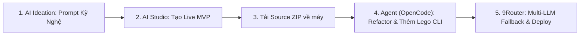
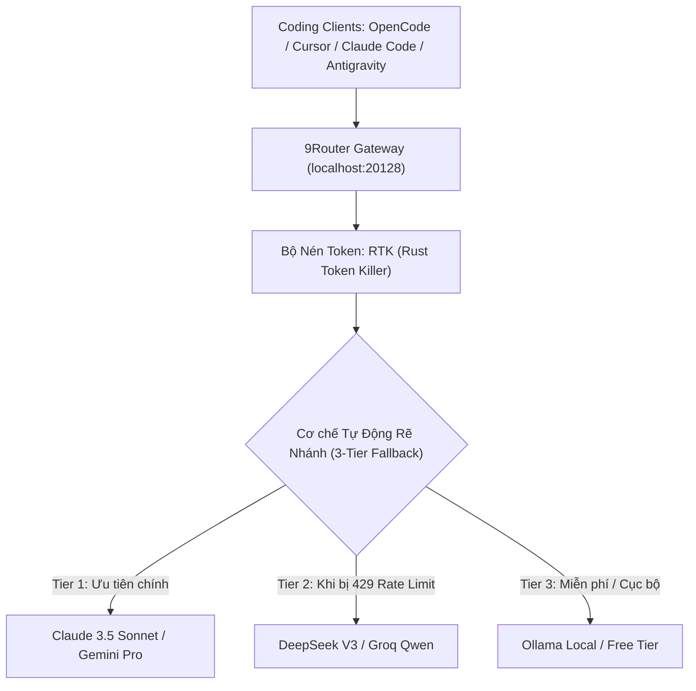

# Quy Trình Vibecoding Tối Tân: Google AI Studio Apps, OpenCode & 9Router Gateway

> **Mục tiêu chuyên sâu**: Hướng dẫn toàn diện quy trình đưa một sản phẩm từ ý tưởng sơ khởi $\rightarrow$ MVP nhanh trên Google AI Studio Apps $\rightarrow$ Tải mã nguồn về cho Agent cục bộ (OpenCode, Antigravity) tái cấu trúc, bảo mật hóa $\rightarrow$ Định tuyến mô hình thông minh và chống tràn chi phí token qua 9Router.

---

## MỤC LỤC TỔNG QUAN

1. [Quy Trình 5 Bước: Từ AI Studio Apps Đến Sản Phẩm Thực Chiến](#1-quy-trình-5-bước-từ-ai-studio-apps-đến-sản-phẩm-thực-chiến)
2. [Cạm Bẫy Bảo Mật & Kỹ Thuật Refactor Mã Nguồn AI Studio](#2-cạm-bẫy-bảo-mật--kỹ-thuật-refactor-mã-nguồn-ai-studio)
3. [Giải Phẫu OpenCode: Terminal Agent Tự Do Thay Thế Claude Code](#3-giải-phẫu-opencode-terminal-agent-tự-do-thay-thế-claude-code)
4. [Giải Phẫu 9Router: Gateway Định Tuyến Đa Mô Hình & Token Killer (RTK)](#4-giải-phẫu-9router-gateway-định-tuyến-đa-mô-hình--token-killer-rtk)
5. [Mô Hình Kiến Trúc Kết Hợp Tối Thượng (The Unified Power Stack)](#5-mô-hình-kiến-trúc-kết-hợp-tối-thượng-the-unified-power-stack)

---

## 1. QUY TRÌNH 5 BƯỚC: TỪ AI STUDIO APPS ĐẾN SẢN PHẨM THỰC CHIẾN

Google AI Studio Apps (`https://aistudio.google.com/apps`) là một trong những nền tảng tạo nguyên mẫu (Prototyping) nhanh nhất hiện nay nhờ sức mạnh của dòng mô hình Gemini 2.0 / 2.5 Flash & Pro.



### Chi tiết 5 bước thực thi:
1. **Bước 1: Soạn thảo Prompt hạt nhân (The Seed Prompt)**:
   - Dùng Agent (hoặc khung JTBD) soạn thảo một prompt đặc tả chức năng rõ ràng, chỉ định công nghệ (ví dụ: React + Tailwind, hoặc Python Streamlit), mô tả dữ liệu mẫu Mock JSON.
2. **Bước 2: Sinh bản thử nghiệm tại Google AI Studio Apps**:
   - Dán prompt vào `https://aistudio.google.com/apps`.
   - AI Studio tự động sinh mã nguồn, render giao diện trực tiếp và kết nối API Gemini thông qua khóa tạm thời.
   - Bấm thử các nút, kiểm tra trải nghiệm người dùng ngay trên trình duyệt trong vòng 30 giây.
3. **Bước 3: Tải mã nguồn (Export Source Code)**:
   - Nhấn nút **Download Code** hoặc xuất tệp ZIP về máy tính.
4. **Bước 4: Bàn giao cho Local Coding Agent (Antigravity / OpenCode)**:
   - Giải nén mã nguồn vào thư mục dự án cục bộ.
   - Kích hoạt tác tử AI cục bộ để vá các cạm bẫy bảo mật, chia nhỏ module và kết nối các vũ khí Lego (yt-dlp, FFmpeg, SQLite, scrcpy).
5. **Bước 5: Định tuyến mô hình tối ưu qua 9Router**:
   - Kết nối Agent vào 9Router để tự động chuyển đổi giữa Gemini, DeepSeek, Claude mà không sợ bị đứt gãy phiên làm việc khi chạm giới hạn hạn mức (HTTP 429).

---

## 2. CẠM BẪY BẢO MẬT & KỸ THUẬT REFACTOR MÃ NGUỒN AI STUDIO

Mã nguồn sinh ra từ Google AI Studio Apps được tối ưu cho việc **chạy thử nghiệm nhanh (Rapid Sandbox)**, do đó thường chứa 3 căn bệnh kỹ thuật nguy hiểm:

### 2.1 Ba điểm yếu chí mạng của code AI Studio Apps
1. **Lộ API Key ở máy khách (Client-Side Key Leakage)**:
   - Code AI Studio thường gọi trực tiếp `@google/genai` từ component React trong trình duyệt:
     ```tsx
     // NGUY HIỂM: Khóa API bị nhúng thẳng vào JavaScript bundle của trình duyệt!
     const ai = new GoogleGenAI({ apiKey: process.env.NEXT_PUBLIC_GEMINI_API_KEY });
     ```
   - Bất kỳ ai mở F12 Network tab đều có thể sao chép khóa API của bạn.
2. **Cấu trúc đơn khối khổng lồ (Monolithic File 400--800 dòng)**:
   - Toàn bộ giao diện, state, styles và API call đều bị nhồi chung vào một tệp `App.tsx`. Khi dự án phình to, AI Agent sẽ bị quá tải ngữ cảnh và làm hỏng logic cũ.
3. **Mock State lỏng lẻo**:
   - Dữ liệu lưu trong RAM cục bộ (`useState`), khi F5 tải lại trang là mất sạch dữ liệu.

### 2.2 Câu lệnh Prompt chuẩn để Agent Refactor toàn diện
Khi vừa tải mã nguồn từ AI Studio về, hãy mở Agent trong thư mục dự án và ra lệnh:

```markdown
Tôi vừa tải mã nguồn nguyên mẫu MVP từ Google AI Studio Apps về thư mục này. 
Hãy thực hiện quy trình chuẩn hóa mã nguồn (Hardening & Refactoring) theo các bước:

1. AN NINH API (Security Gate):
   - Chuyển toàn bộ các lệnh gọi SDK AI (@google/genai) ra khỏi Frontend React.
   - Tạo một API route backend (hoặc Server Action / FastAPI service) để bảo vệ API key tuyệt đối trong biến môi trường máy chủ (không dùng tiền tố NEXT_PUBLIC_).

2. PHÂN RÃ MÔ-ĐUN SIÊU NHỎ (< 200 dòng/tệp):
   - Tách tệp App.tsx khổng lồ thành:
     * types/app.types.ts (chứa Interfaces & Zod Schema)
     * services/ai.service.ts (chuyên gọi backend)
     * components/ (các UI component nhỏ, áp dụng quy chuẩn Anti-AI-Slop 60-30-10)

3. LƯU TRỮ BỀN VỮNG:
   - Thay thế useState tạm bợ bằng kho lưu trữ bền vững (Local-first SQLite / Supabase hoặc LocalStorage có kiểm duyệt).

4. KIỂM THỬ TỰ ĐỘNG:
   - Chạy lệnh build (npm run build hoặc tsc --noEmit) để kiểm tra toàn bộ lỗi kiểu dữ liệu và báo cáo kết quả.
```

---

## 3. GIẢI PHẪU OPENCODE: TERMINAL AGENT TỰ DO THAY THẾ CLAUDE CODE

### 3.1 OpenCode là gì?
**OpenCode** (`anomalyco/opencode`) là một tác tử lập trình dòng lệnh nguồn mở (Open-Source Terminal AI Coding Agent) được xây dựng bằng ngôn ngữ **Go** với giao diện **Bubble Tea TUI** cực kỳ mượt mà.

Nếu như **Claude Code** của Anthropic bị khóa chặt trong hệ sinh thái Claude (bắt buộc trả phí theo token của Anthropic), thì **OpenCode là một nền tảng mở hoàn toàn (Provider-Agnostic)**:
- Cho phép bạn dùng bất kỳ mô hình nào: **Google Gemini 2.0**, **Claude 3.5 Sonnet**, **OpenAI GPT-4o**, **DeepSeek V3/R1**, hoặc các mô hình mã nguồn mở chạy cục bộ qua **Ollama**.

### 3.2 Các tính năng vượt trội của OpenCode
1. **Hai chế độ tác tử chuyên biệt (Toggle bằng phím Tab)**:
   - **Chế độ `plan` (Architect Mode)**: Chỉ có quyền đọc mã nguồn (`glob`, `grep`, `view`), phân tích kiến trúc, lập danh sách bước thực hiện, **tuyệt đối không sửa file**.
   - **Chế độ `build` (Implementer Mode)**: Toàn quyền chỉnh sửa tệp, hiển thị bản so sánh sai khác (*git diff preview*), và thực thi lệnh shell trong terminal.
2. **Khả năng hiểu ngữ cảnh cơ sở mã nguồn (Codebase Indexing)**:
   - Tự động lập chỉ mục tệp, hỗ trợ tìm kiếm ngữ nghĩa và tự động nạp các tệp liên quan khi người dùng hỏi về một tính năng.
3. **Tích hợp GitHub App tự động**:
   - Có thể gắn vào GitHub Repo; lập trình viên chỉ cần bình luận `/opencode` trên Pull Request hoặc Issue, OpenCode sẽ tự tạo commit sửa lỗi.

### 3.3 Cài đặt & Sử dụng nhanh OpenCode

```bash
# Cài đặt qua script chính thức (Linux / macOS):
curl -fsSL https://opencode.ai/v2/install | bash

# Hoặc cài đặt qua npm:
npm i -g @opencode/cli@latest

# Khởi chạy giao diện TUI tương tác trong thư mục dự án:
opencode

# Hoặc chạy lệnh dòng lệnh không tương tác (Headless mode):
opencode run "Kiểm tra toàn bộ các tệp TSX xem có tệp nào vượt quá 200 dòng không"
```

---

## 4. GIẢI PHẪU 9ROUTER: GATEWAY ĐỊNH TUYẾN ĐA MÔ HÌNH & TOKEN KILLER (RTK)

### 4.1 9Router là gì?
**9Router** (`9router.com`) là một trạm trung chuyển API thông minh (Smart AI Gateway & Router) dành riêng cho các lập trình viên sử dụng AI coding tools.

Thay vì cấu hình từng khóa API riêng lẻ cho từng công cụ (Cursor, OpenCode, Claude Code, Cline), bạn chỉ cần trỏ tất cả các công cụ về một điểm đến duy nhất:
\begin{center}
\textbf{OpenAI-Compatible Local Endpoint:} \texttt{http://localhost:20128/v1}
\end{center}



### 4.2 Hai vũ khí sát thủ của 9Router

#### 1. Cơ chế Tự động Rẽ nhánh 3 tầng (3-Tier Auto-Fallback)
Khi bạn đang để tác tử tự động chạy vòng lặp sửa lỗi mã nguồn, thảm họa lớn nhất là tài khoản AI của bạn bị dính lỗi **HTTP 429 Quota Exceeded (Hết hạn mức yêu cầu)**. Phiên làm việc bị sập và agent dừng lại giữa chừng.
- Với 9Router: Khi tầng 1 (ví dụ Claude) trả về mã 429, 9Router **tự động chuyển hướng yêu cầu sang tầng 2 (Gemini 2.0 Flash) hoặc tầng 3 (DeepSeek)** trong vòng 100ms mà không làm gián đoạn kịch bản của Agent.

#### 2. Bộ Nén Token RTK (Rust Token Killer)
- Trong các công cụ coding agent, các lệnh như `git diff` hoặc thông báo log thường chứa hàng chục nghìn ký tự khoảng trắng thừa, chú thích lặp lại và chuỗi metadata rác.
- RTK là module viết bằng ngôn ngữ Rust được tích hợp sẵn trong 9Router, tự động cắt lọc và tối ưu hóa các prompt coding trước khi gửi lên API đám mây, giúp **giảm từ 20% đến 65% lượng token tiêu thụ**, tiết kiệm hàng trăm USD chi phí mỗi tháng.

### 4.3 Cài đặt và Kết nối 9Router

```bash
# Cài đặt toàn cục qua npm:
npm install -g 9router

# Khởi chạy router ngầm trên cổng 20128:
9router

# Trong OpenCode hoặc Cursor, cấu hình OpenAI Base URL:
# Base URL: http://localhost:20128/v1
# API Key: (Khóa quản trị tạo từ 9Router Dashboard)
```

---

## 5. MÔ HÌNH KIẾN TRÚC KẾT HỢP TỐI THƯỢNG (THE UNIFIED POWER STACK)

Khi kết hợp toàn bộ các công cụ trên, bạn sở hữu một quy trình phát triển phần mềm thần tốc và độc lập nhất năm 2026:

1. **Ý tưởng $\rightarrow$ Giao diện sống (30s)**:
   - Dùng **Google AI Studio Apps** sinh bản giao diện mẫu tương tác được.
2. **Tải mã nguồn $\rightarrow$ Refactor kiến trúc (5 phút)**:
   - Mở **OpenCode** (chế độ `plan` rồi sang `build`), bóc tách tệp AI Studio thành kiến trúc sạch: Micro-modules < 200 dòng, Schema Zod, tách API backend.
3. **Ghép nối các vũ khí Lego chuyên sâu**:
   - Cần cào phụ đề YouTube? Bọc lệnh [`yt-dlp`](file:///home/tontonyuta/Documents/Vibecoding/scripts/media_transcriber_pipeline.py).
   - Cần nén/cắt video? Bọc lệnh `ffmpeg`.
   - Cần điều khiển điện thoại? Bọc lệnh [`adb / scrcpy`](file:///home/tontonyuta/Documents/Vibecoding/scripts/mobile_adb_controller.py).
   - Cần chuyển đổi tài liệu Word/Excel sang PDF? Bọc lệnh [`libreoffice --headless`](file:///home/tontonyuta/Documents/Vibecoding/scripts/office_headless_converter.sh).
4. **Vận hành liên tục không đứt gãy**:
   - Sử dụng **9Router** làm gateway điều phối, tận dụng mô hình rẻ/miễn phí cho các tác vụ phụ và mô hình mạnh cho khâu kiến trúc, tự động fallback khi cạn quota.
5. **Tự động kiểm thử & Bàn giao sạch bóng lỗi**:
   - Chạy kịch bản [`self_healing_test_runner.py`](file:///home/tontonyuta/Documents/Vibecoding/scripts/self_healing_test_runner.py) để đảm bảo 0 lỗi console, 0 lỗi mạng trước khi đóng gói thành phẩm qua **Tauri** hoặc **PyInstaller**.
