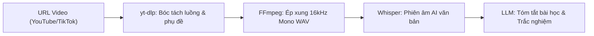

# Đại Thư Viện Vũ Khí Nguồn Mở & Kỹ Nghệ Ghép Lego Cho Vibecoder 2026
## Bách Khoa Toàn Thư Hơn 50+ Công Cụ, Tiện Ích Dòng Lệnh & Kịch Bản Cấp Thấp

> **Triết lý sống còn**: Không phát minh lại bánh xe. Một lập trình viên Vibecoding thượng thừa là người nắm giữ bản đồ của những vũ khí nguồn mở mạnh nhất hành tinh, thấu hiểu ranh giới kỹ thuật của từng công cụ, và dùng AI làm chất keo kết nối các khối Lego có sẵn thành một sản phẩm thương mại hoàn chỉnh trong thời gian tính bằng phút.

---

## MỤC LỤC 10 PHÂN HỆ VŨ KHÍ NGUỒN MỞ

1. [Phân Hệ 1: Cào Dữ Liệu & Bóc Tách Web Ninja (Jina Reader, Crawl4AI, Nodriver, Firecrawl)](#phân-hệ-1-cào-dữ-liệu--bóc-tách-web-ninja)
2. [Phân Hệ 2: Backend Đóng Hộp & Cơ Sở Dữ Liệu Nhúng (PocketBase, DuckDB, SQLite FTS5)](#phân-hệ-2-backend-đóng-hộp--cơ-sở-dữ-liệu-nhúng)
3. [Phân Hệ 3: Mạng Ngầm, Tunnels & Reverse Proxy (Cloudflared, Mitmproxy, Caddy, Tailscale)](#phân-hệ-3-mạng-ngầm-tunnels--reverse-proxy)
4. [Phân Hệ 4: Xử Lý Media, Video & Giọng Nói Tối Thượng (yt-dlp, FFmpeg, WhisperX, Kokoro, Rembg)](#phân-hệ-4-xử-lý-media-video--giọng-nói-tối-thượng)
5. [Phân Hệ 5: Tác Tử Dòng Lệnh & Định Tuyến AI (OpenCode, Aider, 9Router, Claude Code)](#phân-hệ-5-tác-tử-dòng-lệnh--định-tuyến-ai)
6. [Phân Hệ 6: Xử Lý Tài Liệu & Xuất Bản Học Thuật (Typst, PyMuPDF, Pandoc, LibreOffice)](#phân-hệ-6-xử-lý-tài-liệu--xuất-bản-học-thuật)
7. [Phân Hệ 7: Điều Khiển Thiết Bị & Mobile Hacking (scrcpy, ADB, UIAutomator)](#phân-hệ-7-điều-khiển-thiết-bị--mobile-hacking)
8. [Phân Hệ 8: Đóng Gói Ứng Dụng Nhanh (Streamlit, Gradio, Tauri v2, PyInstaller, InnoSetup)](#phân-hệ-8-đóng-gói-ứng-dụng-nhanh)
9. [Phân Hệ 9: Chuyên Sâu Scripting & OS Internals (Linux IPC/Signals vs Windows PowerShell/AHK)](#phân-hệ-9-chuyên-sâu-scripting--os-internals)
10. [Phân Hệ 10: Quy Trình Prototyping Tối Tân (Google AI Studio Apps $\to$ Local Agent $\to$ 9Router)](#phân-hệ-10-quy-trình-prototyping-tối-tân)

---

## PHÂN HỆ 1: CÀO DỮ LIỆU & BÓC TÁCH WEB NINJA

Khi cần nạp tài liệu từ Internet vào AI, đa số người mới nghĩ ngay đến việc bật Playwright/Selenium. Đây là sai lầm lãng phí tài nguyên nhất. Dưới đây là 4 vũ khí bóc tách web thế hệ mới:

### 1.1 Jina Reader (`https://r.jina.ai/[URL]`) - Tuyệt Kỹ 0 Dòng Code
- **Bản chất**: Dịch vụ proxy chuyển đổi bất kỳ trang web nào thành Markdown sạch sẽ chỉ bằng cách thêm tiền tố URL.
- **Cách dùng thần tốc**:
  ```bash
  # Lấy nội dung sạch của bài viết báo chí hoặc tài liệu kỹ thuật:
  curl -s "https://r.jina.ai/https://vietnamnet.vn/bai-viet-mau"
  ```
- **Ưu điểm**: 0 dòng cấu hình, 0 cài đặt, không tốn RAM chạy browser, tự lọc bỏ banner, quảng cáo, menu rác.
- **Hạn chế**: Không tương tác được với các form yêu cầu đăng nhập phức tạp.

### 1.2 Crawl4AI - Async Crawler Đỉnh Cao Dành Riêng Cho LLM
- **Bản chất**: Thư viện Python mã nguồn mở chạy cục bộ, tối ưu hóa Playwright ngầm để bóc tách DOM và tự động chia đoạn (*chunking*) cho RAG.
- **Ưu điểm**: Hoàn toàn miễn phí, dữ liệu nằm trên máy bạn, hỗ trợ bóc tách JSON theo Zod/Pydantic schema.
- **Lệnh cài đặt**: `pip install crawl4ai && crawl4ai-setup`

### 1.3 Nodriver - Sát Thủ Bẻ Gãy Bức Tường Lửa Cloudflare / Akamai
- **Bản chất**: Dự án Python kế thừa `undetected-chromedriver`, giao tiếp trực tiếp qua Chrome DevTools Protocol (CDP) mà **không dùng webdriver**.
- **Tại sao nó vượt trội Playwright?**: Playwright và Selenium luôn để lại cờ dấu vết `navigator.webdriver = true` khiến các hệ thống chống bot như Cloudflare Turnstile nhận diện và chặn đứng. `nodriver` hoàn toàn vô hình trước các bộ lọc bot này.

### 1.4 Bảng Đối Chiếu Quyết Định Vũ Khí Web

| Tình huống cần giải quyết | Vũ khí số 1 | Lý do lựa chọn |
| :--- | :--- | :--- |
| Đọc bài báo, blog, tài liệu học thuật | **Jina Reader** (`r.jina.ai`) | Tốc độ < 1s, tốn 0 MB RAM, xuất Markdown sạch |
| Xây dựng hệ thống RAG cào hàng nghìn trang | **Crawl4AI** | Xử lý bất đồng bộ, trích xuất cấu trúc schema chuẩn |
| Cào các trang web có Cloudflare / CAPTCHA | **Nodriver** | Bỏ qua webdriver flag, tàng hình 100% |
| Kiểm thử WebApp tương tác, bắt lỗi Console | **Playwright** | Đầy đủ assertion, network mock, chụp ảnh giao diện |

---

## PHÂN HỆ 2: BACKEND ĐÓNG HỘP & CƠ SỞ DỮ LIỆU NHÚNG

### 2.1 PocketBase: "Kẻ Hủy Diệt" Supabase Cho Các Bản MVP
- **Bản chất**: Một tệp binary duy nhất viết bằng Go (chỉ nặng khoảng 15MB) tích hợp sẵn:
  * Cơ sở dữ liệu SQLite nhúng.
  * Hệ thống xác thực người dùng (Auth qua Email, OAuth2 Google/GitHub).
  * Quản lý tệp tải lên (File Storage tương thích S3).
  * Đăng ký dữ liệu thời gian thực (Realtime subscriptions qua SSE).
  * Giao diện quản trị Admin UI trực quan cực đẹp.
- **Cách khởi chạy trong 5 giây**:
  ```bash
  ./pocketbase serve --http="0.0.0.0:8090"
  ```
- **Tại sao Vibecoder mê mẩn PocketBase?**: Bạn không cần cấu hình Docker phức tạp, không cần tài khoản Cloud Supabase, toàn bộ cơ sở dữ liệu nằm gọn trong 1 tệp `pb_data/data.db`, dễ dàng sao chép và backup chỉ bằng lệnh `cp`.

### 2.2 DuckDB: Con Quái Vật Phân Tích Dữ Liệu Trong Bộ Nhớ (In-Process OLAP)
- **Bản chất**: Được mệnh danh là "SQLite của ngành phân tích dữ liệu lớn".
- **Sức mạnh**: Cho phép thực thi các câu lệnh SQL phân tích trên các tệp Parquet, CSV, JSON khổng lồ (hàng chục triệu dòng) chỉ trong vài phần trăm giây mà không cần dựng cụm Spark hay PostgreSQL.
- **Ví dụ một dòng lệnh Python**:
  ```python
  import duckdb
  # Đọc thẳng file CSV và lọc dữ liệu bằng SQL siêu tốc:
  duckdb.sql("SELECT category, AVG(price) FROM 'large_data.csv' GROUP BY category").show()
  ```

### 2.3 SQLite FTS5: Bộ Máy Tìm Kiếm Toàn Văn Cục Bộ Siêu Nhẹ
- Tích hợp sẵn trong engine SQLite tiêu chuẩn của Python.
- Hỗ trợ đánh chỉ mục toàn văn (*Full-Text Indexing*), tìm kiếm mờ (*prefix search*), và tô đậm từ khóa (*snippet highlighting*) mà không cần cài đặt Elasticsearch nặng nề.

---

## PHÂN HỆ 3: MẠNG NGẦM, TUNNELS & REVERSE PROXY

### 3.1 Cloudflared Tunnel: Mở Cổng Localhost Ra Toàn Cầu Trong 3 Giây
- **Bản chất**: Tiện ích chính thức của Cloudflare giúp đưa bất kỳ cổng nội bộ nào (`localhost:3000`, `localhost:8080`) ra Internet dưới dạng tên miền HTTPS bảo mật công khai mà:
  * **Không cần mở cổng Router (No Port Forwarding)**.
  * **Không cần IP tĩnh (Static IP)**.
  * **Hoàn toàn miễn phí, có chứng chỉ SSL chuẩn**.
- **Lệnh kích hoạt tức thì**:
  ```bash
  cloudflared tunnel --url http://localhost:3000
  ```
  Terminal sẽ lập tức trả về một đường link dạng `https://xxxx.trycloudflare.com` để bạn gửi cho đối tác hoặc thử nghiệm Webhook trên điện thoại!

### 3.2 Mitmproxy: Kính Hiển Vi Bắt & Bẻ Gãy Lưu Lượng Mạng (SSL Proxy)
- **Bản chất**: Trình bắt chặn gói tin tương tác bằng giao diện dòng lệnh (CLI TUI) hoặc Web.
- **Kỹ thuật Hacker**: Viết script Python để tự động sửa đổi gói tin HTTP/HTTPS đi qua:
  ```python
  # addon.py: Tự động đổi phản hồi API của bên thứ ba
  def response(flow):
      if "api.example.com/user" in flow.request.pretty_url:
          flow.response.text = flow.response.text.replace('"is_vip": false', '"is_vip": true')
  ```
  Khởi chạy: `mitmproxy -s addon.py`

### 3.3 Caddy Server: Máy Chủ Web Tự Động HTTPS Thay Thế Nginx
- Cấu hình 1 dòng duy nhất trong tệp `Caddyfile`:
  ```caddy
  myapp.com {
      reverse_proxy localhost:3000
  }
  ```
  Caddy tự động đăng ký chứng chỉ Let's Encrypt SSL và gia hạn tự động, giải phóng bạn khỏi mớ cấu hình rườm rà của Nginx và Certbot.

---

## PHÂN HỆ 4: XỬ LÝ MEDIA, VIDEO & GIỌNG NÓI TỐI THƯỢNG

### 4.1 yt-dlp & FFmpeg: Cặp Bài Trùng Kỹ Nghệ Media



#### Công thức FFmpeg thực chiến:
1. **Nén video tối đa mà mắt thường không nhận ra (CRF 23 - H.264)**:
   ```bash
   ffmpeg -i raw_input.mov -vcodec libx264 -crf 23 -preset slow -acodec aac -b:a 128k output_web.mp4
   ```
2. **Kích hoạt mã hóa phần cứng GPU (NVIDIA NVENC)**:
   ```bash
   ffmpeg -i input.mp4 -c:v h264_nvenc -preset p5 -b:v 5M output_fast.mp4
   ```
3. **Cắt video siêu tốc không cần re-encode (Stream Copy)**:
   ```bash
   ffmpeg -ss 00:01:30 -to 00:03:45 -i input.mp4 -c copy cut_segment.mp4
   ```

### 4.2 Kokoro & Edge-TTS: Tạo Giọng Nói Tự Nhiên Không Tốn 1 Xu
- **Edge-TTS**: Thư viện Python giao tiếp với endpoint TTS của Microsoft Edge, cho phép tổng hợp giọng đọc tiếng Việt và tiếng Anh siêu tự nhiên, tốc độ cao mà **không cần API Key hay thẻ tín dụng**:
  ```bash
  edge-tts --voice vi-VN-NamMinhNeural --text "Chào mừng bạn đến với giáo trình Vibecoding" --write-media welcome.mp3
  ```
- **Kokoro**: Mô hình TTS mã nguồn mở chạy cục bộ chỉ với 82 triệu tham số, tốc độ xử lý nhanh gấp 10 lần thời gian thực (Real-Time Factor 0.1x) trên CPU thông thường!

### 4.3 Rembg: Xóa Nền Ảnh Chỉ Bằng 1 Dòng Code Python
- Sử dụng mô hình U2-Net chạy qua ONNX runtime cục bộ:
  ```python
  from rembg import remove
  from PIL import Image

  input_img = Image.open('product.jpg')
  output_img = remove(input_img)
  output_img.save('product_transparent.png')
  ```

---

## PHÂN HỆ 5: TÁC TỬ DÒNG LỆNH & ĐỊNH TUYẾN AI

### 5.1 Aider vs OpenCode vs Claude Code

| Tiêu chí | Aider | OpenCode (`anomalyco/opencode`) | Claude Code |
| :--- | :--- | :--- | :--- |
| **Bản chất** | CLI Pair-programmer tập trung Git | TUI Agent tương tác viết bằng Go | Terminal Agent đóng của Anthropic |
| **Giao diện** | Dòng lệnh thuần túy | **TUI Bubble Tea tuyệt đẹp** | Dòng lệnh Markdown |
| **Mô hình hỗ trợ** | Tất cả (OpenAI, Claude, DeepSeek, Ollama) | **Tất cả (Đa nhà cung cấp / Local)** | Chỉ độc quyền dòng Claude |
| **Quản lý Git** | **Tự động commit kèm message chuẩn** | Hiện Git diff preview trước khi lưu | Tự chạy lệnh git qua bash |
| **Chi phí** | Miễn phí (chỉ trả tiền token) | Miễn phí (chỉ trả tiền token) | Đắt (yêu cầu Anthropic Pro/API) |

### 5.2 9Router: Trạm Kiểm Soát Token & Chống Sập Phiên
- Cung cấp cổng OpenAI-compatible tại `http://localhost:20128/v1`.
- **3-Tier Fallback**: Khi Claude dính 429 $\rightarrow$ Rẽ sang Gemini 2.0 Flash $\rightarrow$ Rẽ tiếp sang DeepSeek V3.
- **RTK (Rust Token Killer)**: Lọc sạch rác trong `git diff`, giảm 20%--65% token tiêu thụ.

---

## PHÂN HỆ 6: XỬ LÝ TÀI LIỆU & XUẤT BẢN HỌC THUẬT

### 6.1 Typst: "Kẻ Kế Vị" Hoàn Hảo Của LaTeX
- **Bản chất**: Hệ thống soạn thảo tài liệu khoa học hiện đại viết bằng ngôn ngữ **Rust**.
- **Tại sao nên thay thế LaTeX bằng Typst?**:
  * Tốc độ biên dịch chỉ mất **vài phần nghìn giây** (trong khi pdflatex mất 2--5 giây).
  * Cú pháp trực quan, dễ đọc, không cần mở hàng chục `\begin{...} \end{...}`.
  * Hỗ trợ công thức Toán học tuyệt đẹp, layout dạng lưới (*grid layout*) chuẩn mực.

### 6.2 PyMuPDF (`fitz`): Cỗ Máy Đọc PDF Nhanh Gấp 50 Lần PyPDF
- Được viết bằng C (dựa trên MuPDF engine).
- Trích xuất văn bản, hình ảnh, bảng biểu và metadata từ tệp PDF 500 trang chỉ trong chưa đầy 1 giây.

---

## PHÂN HỆ 7: ĐIỀU KHIỂN THIẾT BỊ & MOBILE HACKING

### 7.1 scrcpy Internals & ADB Shell
- **Kiến trúc scrcpy**: Đẩy `scrcpy-server.jar` lên Android, bắt luồng khung hình trực tiếp từ Display Subsystem, truyền H.264 qua Unix Socket với độ trễ < 30ms.
- **Tự động hóa Android không cần code app**:
  * `adb shell screencap -p`: Lấy ảnh màn hình.
  * `adb shell uiautomator dump`: Lấy cây XML tọa độ nút bấm.
  * `adb shell input tap X Y`: Nhấn nút.
  * `adb shell input text "string"`: Nhập liệu.

---

## PHÂN HỆ 8: ĐÓNG GÓI ỨNG DỤNG NHANH

### 8.1 Streamlit / Gradio: UI Web Trong 10 Dòng Python
Thích hợp tuyệt đối cho các công cụ AI, phân tích dữ liệu nội bộ.

### 8.2 Tauri v2: Ứng Dụng Desktop & Mobile Siêu Nhẹ 5MB
- Sử dụng WebView gốc của hệ điều hành (Edge WebView2 trên Windows, WebKitGTK trên Linux) kết hợp lõi Rust.
- **So với Electron (150MB, ngốn 300MB RAM)**, ứng dụng Tauri chỉ nặng **5MB** và chỉ ngốn **30MB RAM**!

### 8.3 InnoSetup & PyInstaller: Đóng Gói File Cài Đặt Windows Chuẩn Doanh Nghiệp
- `pyinstaller --onefile`: Nén toàn bộ code Python và thư viện vào 1 file `.exe`.
- `InnoSetup`: Tạo trình cài đặt chuyên nghiệp (`Setup.exe`), tự tạo biểu tượng Desktop, đăng ký Registry và hỗ trợ gỡ cài đặt.

---

## PHÂN HỆ 9: CHUYÊN SÂU SCRIPTING & OS INTERNALS

### 9.1 Linux Hacker Scripting
- **File Descriptors**: `exec 3<>/tmp/ipc.pipe` (Named Pipe FIFO cho giao tiếp liên tiến trình).
- **Signal Traps**: `trap cleanup SIGINT SIGTERM EXIT` (Dọn dẹp tiến trình con).
- **Event Daemon**: `inotifywait -m -e modify ./src/ | while read ...` (Tự kích hoạt kịch bản khi tệp thay đổi).
- **Xargs Parallel**: `xargs -P 8` (Chạy song song tối đa hóa CPU).

### 9.2 Windows Hacker Scripting
- **PowerShell Object Pipeline**: Dữ liệu truyền đi là các đối tượng .NET có kiểu dữ liệu mạnh (`$process.WorkingSet`), không phải chuỗi ký tự thô.
- **P/Invoke Win32 API**: Gọi trực tiếp DLL của hệ điều hành Windows (`user32.dll`, `kernel32.dll`).
- **AutoHotkey (AHK v2)**: Bắt hook bàn phím và chuột cấp thấp để tự động hóa mọi phần mềm GUI cũ kỹ.

---

## PHÂN HỆ 10: QUY TRÌNH PROTOTYPING TỐI TÂN (AI STUDIO $\to$ AGENT $\to$ DEPLOY)

1. **Bước 1**: Viết prompt nghiệp vụ $\to$ Dán vào **Google AI Studio Apps** (`aistudio.google.com/apps`) để có ngay bản MVP chạy trực tiếp trên web trong 30 giây.
2. **Bước 2**: Tải source code ZIP về máy.
3. **Bước 3**: Mở **OpenCode** hoặc **Antigravity**, bóc tách API ra khỏi frontend để bảo vệ API Key, phân rã `App.tsx` thành các module < 200 dòng.
4. **Bước 4**: Ghép nối các vũ khí Lego cục bộ (`yt-dlp`, `FFmpeg`, `PocketBase`, `scrcpy`).
5. **Bước 5**: Chạy kịch bản tự phục hồi mã nguồn [`self_healing_test_runner.py`](file:///home/tontonyuta/Documents/Vibecoding/scripts/self_healing_test_runner.py) để đảm bảo 0 lỗi console/mạng trước khi đóng gói thành phẩm!
